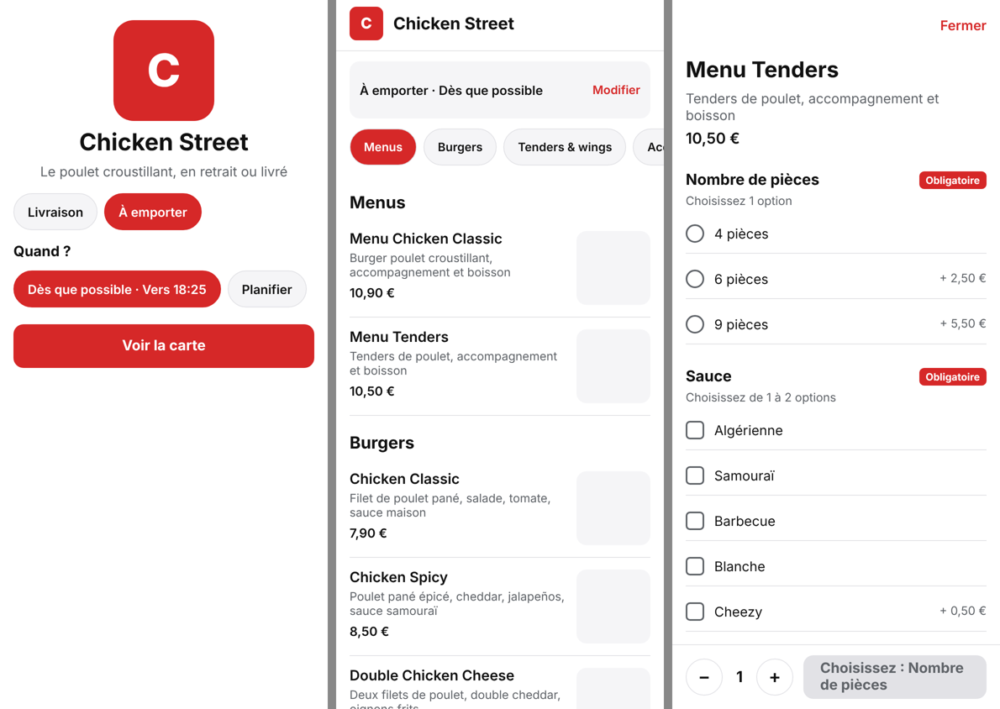

# Environnement de recette

Valeurs **publiques** de l'environnement de recette (aucun secret ici : les secrets vont dans les variables d'environnement de l'hébergeur).

## Supabase

| Élément | Valeur |
|---|---|
| Projet | `splash360-commnde-recette` — référence `yfrvtrebukdbxnuqhlfy`, organisation Splash 360, région `eu-west-3` (Paris), Postgres 17 |
| URL | `https://yfrvtrebukdbxnuqhlfy.supabase.co` |
| Clé publiable | `sb_publishable_S6sTwCD5rcnrtR5gk-SInQ_2KwqX64e` |
| JWKS (vérification des sessions par l'API) | `https://yfrvtrebukdbxnuqhlfy.supabase.co/auth/v1/.well-known/jwks.json` (clés ES256) |
| Émetteur des jetons | `https://yfrvtrebukdbxnuqhlfy.supabase.co/auth/v1` |

État au 2026-11-22 : les 6 migrations de `supabase/migrations/` sont appliquées, ainsi que les données de démonstration (`seed.sql`). Contrôles : 18 tables, toutes avec RLS et `tenant_id`, aucune règle d'ouverture. L'audit Supabase signale « RLS activée sans règle » sur chaque table : c'est voulu (ADR 0002, tout passe par l'API).

### Variables à renseigner

**API (`apps/api`)**

```
DATABASE_URL=postgresql://postgres.yfrvtrebukdbxnuqhlfy:<mot de passe de la base>@aws-0-eu-west-3.pooler.supabase.com:6543/postgres
SUPABASE_JWKS_URL=https://yfrvtrebukdbxnuqhlfy.supabase.co/auth/v1/.well-known/jwks.json
SUPABASE_JWT_ISSUER=https://yfrvtrebukdbxnuqhlfy.supabase.co/auth/v1
```

Le mot de passe de la base a été choisi à la création du projet (Supabase › Project Settings › Database) ; l'hôte exact du pooler est affiché sur le bouton « Connect » du projet.

**Back-office (`apps/admin`)**

```
NEXT_PUBLIC_SUPABASE_URL=https://yfrvtrebukdbxnuqhlfy.supabase.co
NEXT_PUBLIC_SUPABASE_ANON_KEY=sb_publishable_S6sTwCD5rcnrtR5gk-SInQ_2KwqX64e
```

### Premier super-administrateur

1. Supabase › Authentication › Users › « Add user » : votre e-mail et un mot de passe (cocher « Auto confirm »).
2. Dans le SQL Editor : `insert into public.staff_users (email, role) values ('<votre e-mail en minuscules>', 'super_admin');`
3. Connexion au back-office avec cet e-mail : le compte est rattaché automatiquement.

## Enseignes de démonstration

| Enseigne | Sous-domaine | Restaurant | Particularités |
|---|---|---|---|
| Pizzeria Bella | `bella` | Bella Bastille | Retrait + livraison, fermé le lundi |
| Green Bowl | `greenbowl` | Green Bowl Opéra | Retrait seul, frais de service 0,50 € |
| **Chicken Street** (exemple) | `chickenstreet` | Chicken Street (démo) — adresse fictive | Tous les jours 11:00–23:00, livraison 1,90/2,90 €, minimum 12 €, offerte dès 30 € ; carte fictive (menus, burgers, tenders, sauces) en attendant la carte Splash360 réelle |



## Stripe (mode test)

- Compte plateforme `acct_1DaN…` (France). Clé secrète de test enregistrée comme secret réseau de l'environnement cloud `click-and-collect` (jamais dans le dépôt).
- Paiement de test de 18,00 € par carte Visa de test puis remboursement : OK (2026-11-22).
- Stripe Connect activé (modèle plateforme, paiements directs, frais Stripe payés par le restaurant, risques gérés par Stripe, tableau de bord Stripe complet).
- Comptes connectés de test (rattachés dans `restaurants.stripe_account_id`) :
  - Bella Bastille : `acct_1UedVlAKHbYphR6t`
  - Green Bowl Opéra : `acct_1UedW6A5tvdaheca`
- **En attente (décision du 2026-11-22)** : terminer leur inscription (lien d'inscription Stripe, bouton « données de test ») pour activer les paiements. Les liens se régénèrent à la demande.
