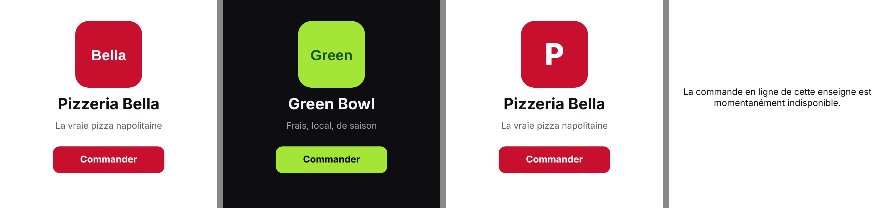

# Lot 1 — Enseigne et thème

**Critère d'acceptation (section 9)** : deux enseignes de test s'affichent chacune avec son logo et sa couleur, sans changer le code.

Statut : **réalisé le 2026-11-22.**



De gauche à droite : Pizzeria Bella (thème clair), Green Bowl (thème sombre, texte du bouton passé en noir automatiquement), Pizzeria Bella avec un logo qui ne charge pas (monogramme de repli), enseigne suspendue.

## Ce qui a été livré

| Couche | Contenu |
|---|---|
| Base | Tables `tenant_theme` et `restaurants` (RLS, contraintes de format), données de démo `supabase/seed.sql` |
| `packages/theme` | Palette calculée depuis la couleur de l'enseigne ; texte des boutons noir ou blanc avec contraste ≥ 4,5:1 garanti (WCAG AA) ; accent remplacé s'il se lit mal sur le fond |
| `packages/contracts` | Schémas zod de la configuration d'enseigne et du format d'erreur |
| `packages/db` | Connexion Postgres serveur et dépôt des enseignes (Postgres + mémoire) |
| `apps/api` | `GET /v1/tenants/{sous-domaine}/config` : 200, 400, 403 (suspendue), 404 ; cache HTTP 60 s ; CORS ; en-têtes de sécurité ; configuration validée au démarrage |
| `apps/mobile` | Résolution de l'enseigne (sous-domaine, variable de build, `?enseigne=` hors production), chargement de la configuration, thème appliqué, écrans d'attente et d'erreur avec « Réessayer », logo avec repli |

Décisions : ADR 0002, 0003 et 0004.

## Vérifier

```bash
pnpm db:start && pnpm db:reset          # base locale + données de démo (Docker)
pnpm --filter api dev                    # API sur :8787 (DATABASE_URL dans apps/api/.env)
pnpm --filter mobile web                 # puis ouvrir :
#   http://localhost:8081/?enseigne=bella
#   http://localhost:8081/?enseigne=greenbowl
#   http://localhost:8081/?enseigne=suspendue
```

## Tests ajoutés

- Thème : 5 tests (contraste, choix noir/blanc, accent).
- Contrat : 3 tests. API : 7 tests (routes, erreurs, CORS, cache).
- Application : 8 tests (résolution de l'enseigne, chargement et erreurs).
- Base : 7 tests pgTAP (RLS, `tenant_id`) et 3 tests d'intégration du dépôt sur Postgres, lancés en CI.

## Reste ouvert

- Logos : URL https saisie en base pour l'instant ; envoi du fichier vers le stockage Supabase avec le module Design du back-office (lot 6).
- Applications sur les stores : une par enseigne (choix par défaut de l'ADR 0004) ou une seule — décision Splash360 (section 11).
