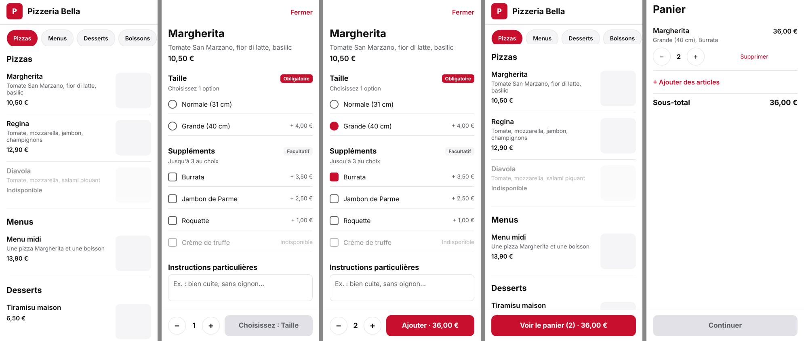

# Lot 2 — Carte

**Critère d'acceptation (section 9)** : la carte d'un restaurant de test Splash360 s'affiche avec photos, prix et options obligatoires.

Statut : **réalisé sur carte de démonstration — branchement à l'API menu Splash360 en attente de sa documentation.**

De gauche à droite : carte (onglets de catégories, produit en rupture grisé), fiche produit (bouton grisé tant que la taille obligatoire manque), fiche remplie (prix recalculé), barre panier, panier.

## Ce qui a été livré

| Couche | Contenu |
|---|---|
| `packages/core` | Types internes de la carte (produits, groupes d'options min/max, suppléments, allergènes, disponibilité) |
| `packages/api-menu` | Interface `MenuProvider` ; cache par restaurant (fraîcheur 3 min, appels simultanés regroupés, bouton « Actualiser » via `invalidate`) ; repli sur la dernière carte connue si l'API tombe, commande bloquée au-delà de `MENU_MAX_STALE_MINUTES` ; cartes de démonstration (Bella, Green Bowl) |
| `packages/db` | Dépôt des restaurants, toujours filtré par enseigne |
| `apps/api` | `GET /v1/tenants/{s}/restaurants` et `GET /v1/tenants/{s}/restaurants/{id}/menu` (503 si carte indisponible, 404 pour le restaurant d'une autre enseigne) |
| `apps/mobile` | Écrans Carte, Fiche produit (options obligatoires/facultatives, min/max, suppléments, instructions, quantité, allergènes), Panier (quantités, suppression, « Ajouter des articles », sous-total) ; panier conservé après fermeture |

Les prix affichés pendant la composition sont indicatifs : le serveur recalcule tout avant paiement (lot 3).

## Ce qu'il reste pour clore le lot

- Écrire l'adaptateur `MenuProvider` de l'API menu Splash360 (traduction vers les types de `packages/core`) et ses tests sur des réponses réelles anonymisées.
- Remplacer `createDemoMenuProvider()` par cet adaptateur dans `apps/api/src/server.ts` (une ligne).
- Fixer `MENU_MAX_STALE_MINUTES` avec Splash360 (actuellement 60 min).
