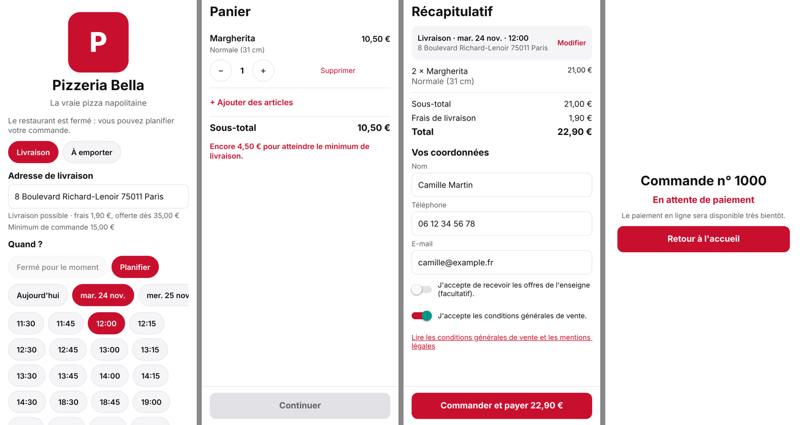

# Lot 3 — Commande

**Critère d'acceptation (section 9)** : une commande planifiée pour le lendemain en livraison est créée avec les bons frais ; les tests de règles passent.

Statut : **réalisé le 2026-11-22.** (Démonstration un dimanche : le lundi étant fermé chez Bella, le premier jour ouvré suivant est le mardi.)

De gauche à droite : accueil (livraison, adresse avec suggestions et contrôle de zone, restaurant fermé donc planification, jour puis créneau), panier bloqué sous le minimum, récapitulatif avec montants recalculés par le serveur, commande créée.

## Ce qui a été livré

| Couche | Contenu |
|---|---|
| `packages/core` | Prix et options (contrôle min/max, disponibilité, doublons, quantités, notes), frais de livraison et seuil de gratuité, minimum, frais de service, zones (rayon ou codes postaux), créneaux (pas, délai, capacité, jours d'avance, fermetures, heure d'été/hiver), « dès que possible ». 33 tests, couverture ≥ 95 % imposée |
| Base | `restaurant_settings`, `opening_hours`, `closures`, `delivery_zones`, `customers`, `orders`, `order_items`, `order_item_options`, `order_events`, numérotation par enseigne ; contrôle d'enseigne par déclencheur sur chaque ligne enfant ; total = somme des montants imposé par la base |
| `packages/db` | Réglages convertis vers `core` ; création de commande en transaction avec verrou par restaurant (pas de survente de créneau, testé avec 6 commandes simultanées), rejeu idempotent |
| `apps/api` | `availability`, `slots`, `delivery-check`, `quote` (recontrôle complet, tous les problèmes renvoyés d'un coup), `POST /orders` (201, ou 200 en rejeu), suggestions d'adresse (Base Adresse Nationale) |
| `apps/mobile` | Accueil (mode, adresse, « dès que possible » ou jour puis heure), rappel modifiable sur la carte, minimum bloquant au panier, récapitulatif serveur, coordonnées, CGV, commande |

## Choix faits (voir aussi `questions-en-attente.md`)

- Frais de service : montant fixe par restaurant.
- Les commandes « dès que possible » ne consomment pas de place de créneau ; une commande en attente de paiement réserve sa place (libérée par l'annulation à 15 min, lot 4).
- Livraison : le délai de trajet (`delivery_minutes`) s'ajoute au délai de préparation pour les créneaux.
- Le client commande en invité (nom, téléphone, e-mail) ; la connexion par code arrive avec le compte client.

## Reste ouvert

- Texte des CGV et mentions légales par enseigne (écran prévu, contenu à saisir au back-office).
- Géocodeur : `GEOCODER_URL` pointe par défaut sur la Géoplateforme IGN (`data.geopf.fr/geocodage/search`) ; à vérifier depuis l'hébergement final.
