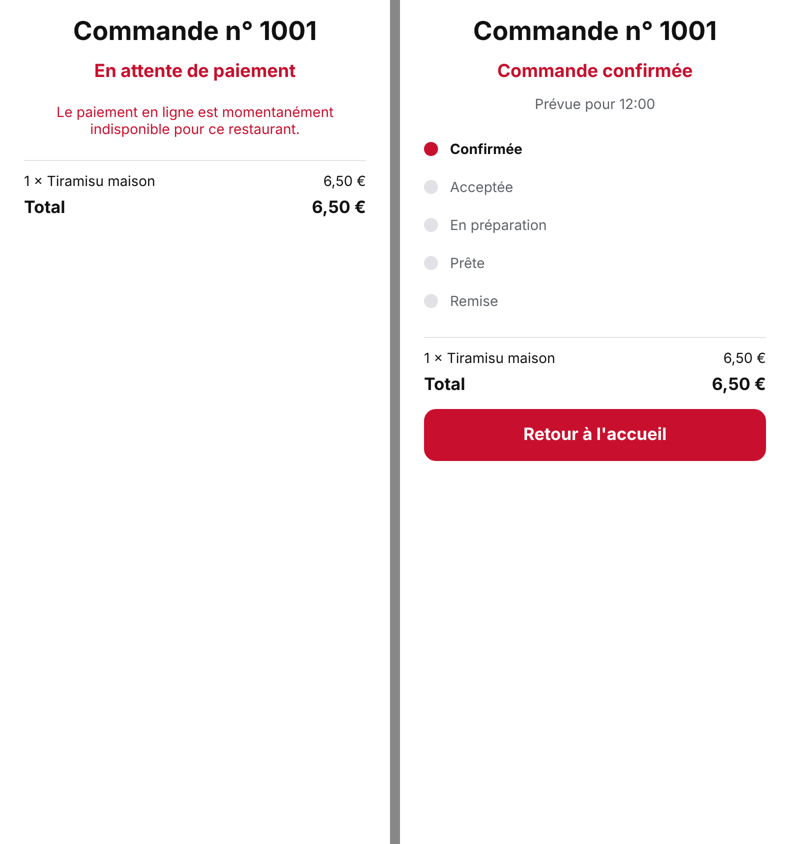

# Lot 4 — Paiement

**Critère d'acceptation (section 9)** : paiement test par carte, Apple Pay et Google Pay ; la commande ne passe à payée que par le webhook ; un remboursement fonctionne.

Statut : **code livré et testé sans réseau Stripe. Reste à faire avec le compte Stripe plateforme : paiement réel en mode test sur web, iOS et Android.**

À gauche : commande créée, paiement indisponible dans cet environnement (Stripe injoignable). À droite : la même commande après un webhook `payment_intent.succeeded` signé — l'application passe seule au suivi.

## Ce qui a été livré

| Couche | Contenu |
|---|---|
| Base | Commission par enseigne (`application_fee_bps`, `application_fee_fixed_cents`), état du compte connecté (`stripe_charges_enabled`), commission et empreinte du jeton de suivi sur la commande |
| `packages/core` | `computeApplicationFee` (pourcentage + fixe, arrondi au centime, plafonné au total) |
| `packages/db` | Passage à « payée » sous verrou avec contrôle du montant et de la devise ; échec ; expiration ; remboursement partiel/total plafonné ; suivi du compte Stripe |
| `apps/api` | `POST /orders/{id}/payment` (PaymentIntent direct sur le compte du restaurant, commission, clé d'idempotence par commande), `GET /orders/{id}` (suivi), `POST /v1/webhooks/stripe` (signature vérifiée sur le corps brut), annulation automatique à 15 min avec annulation du PaymentIntent, service de remboursement (Stripe puis base, clé d'idempotence par demande) |
| `apps/mobile` | Feuille de paiement Stripe native (Apple Pay / Google Pay / carte) et Payment Element sur le web ; écran de suivi qui attend la confirmation du serveur |

## Sécurité

- Le client reçoit un **jeton de suivi** (HMAC de l'identifiant de commande, clé `ORDER_TOKEN_SECRET`) ; la base n'en garde que l'empreinte SHA-256, comparée en temps constant. Sans jeton, une commande est introuvable (404, pas de fuite d'existence).
- Aucune donnée de carte ne passe par nos serveurs ; seule la clé publiable Stripe est envoyée à l'application.
- Un webhook dont le montant ne correspond pas à la commande est rejeté et journalisé.
- Un paiement qui aboutit après l'expiration de la commande la rattrape (le client a payé, on ne perd pas la commande).

## Tests

- 16 tests de routes et de service (jeton, session, webhook, doublon, montant falsifié, échec puis nouvel essai, expiration, remboursements, compte désactivé) + vérification des **vraies signatures Stripe** avec la bibliothèque officielle.
- 4 tests d'intégration Postgres (paiement unique, remboursements, expiration, lecture du détail cloisonnée).
- Essai de bout en bout : commande passée dans le navigateur, webhook signé envoyé à l'API, l'écran bascule sur « Commande confirmée ».

## À faire avec les accès Stripe

1. Créer le compte plateforme Stripe Splash360 et activer Connect ; renseigner `STRIPE_SECRET_KEY`, `STRIPE_PUBLISHABLE_KEY`, `STRIPE_WEBHOOK_SECRET` (webhook « Connect » : `payment_intent.succeeded`, `payment_intent.payment_failed`, `account.updated`).
2. Inscription des restaurants (Stripe Connect onboarding) depuis le back-office — lot 6.
3. Apple Pay : identifiant marchand par enseigne dans le profil EAS, domaine web vérifié chez Stripe.
4. Rejouer le critère d'acceptation sur web, iOS et Android (build de développement EAS).
