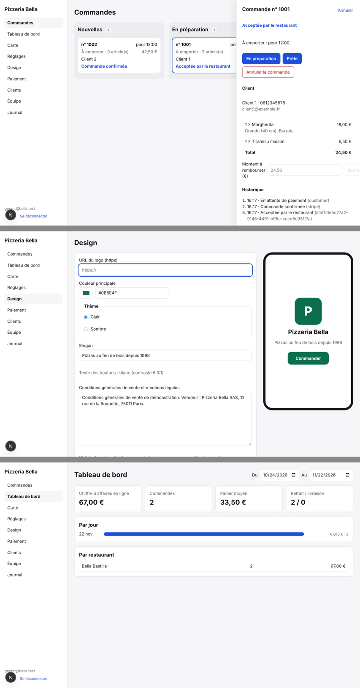

# Lot 6 — Back-office complet

**Critère d'acceptation (section 9)** : un administrateur d'enseigne change son logo et ses frais de livraison et les voit dans l'application ; il ne voit aucune autre enseigne.

Statut : **réalisé le 2026-11-22** (connexion de développement ; Supabase Auth à brancher avec le projet Supabase de recette).

De haut en bas : tableau des commandes et détail d'une commande, design avec aperçu et contrôle de contraste, tableau de bord.

## Démonstration du critère (base réelle)

1. Connexion en tant que `gerant@bella.test` : la navigation n'affiche pas « Enseignes ».
2. Design : couleur `#0B6E4F`, nouveau slogan → `GET /v1/tenants/bella/config` renvoie immédiatement le nouveau thème.
3. Réglages : frais de la zone « moins de 2 km » à 2,50 € → `delivery-check` renvoie `feeCents: 250`.
4. Avec le jeton du gérant de Bella, `X-Tenant-Id` d'une autre enseigne n'a aucun effet ; `/v1/admin/tenants` → 403. Un autre compte Auth présentant le même e-mail est refusé.
5. Journal : `theme.update`, `legal.update`, `settings.update` avec l'auteur.

## Ce qui a été livré

| Couche | Contenu |
|---|---|
| ADR | [0005](adr/0005-back-office-auth.md) : identité Supabase Auth, droits et données via `apps/api` |
| Base | `staff_users` (rôles, rattachement au 1er login), `audit_logs`, `menu_overrides`, CGV par enseigne, zones archivées |
| `apps/api` | `/v1/admin/*` : vérification du jeton (JWKS ou HS256), rôles, « se connecter en tant que » ; commandes (liste, détail, statuts, annulation, remboursement), alertes caisse et relance, pause, design, CGV, réglages validés, carte (aperçu, actualiser, masquer/ordonner — appliqué à la carte publique et à la commande), tableau de bord, clients (recherche, export CSV protégé contre l'injection de formules, anonymisation RGPD), équipe, journal, enseignes, inscription Stripe Connect |
| `apps/admin` | Connexion, navigation par rôle, sélecteur d'enseigne (super-admin), pages Commandes (rafraîchies toutes les 5 s), Tableau de bord, Carte, Réglages, Design, Paiement, Clients, Équipe, Journal, Enseignes |

## Tests

- 12 tests de routes du back-office (authentification et jetons falsifiés/expirés, cloisonnement, rôles, journal, remboursement, design servi à l'application, produit masqué non commandable, validation des réglages, export CSV, invitations, création d'enseigne).
- 5 tests d'intégration Postgres du back-office (rattachement au 1er login, réglages, tableau de bord, anonymisation, création d'enseigne).

## Reste à faire

- Brancher Supabase Auth (projet de recette) : `NEXT_PUBLIC_SUPABASE_URL`, `NEXT_PUBLIC_SUPABASE_ANON_KEY`, `SUPABASE_JWKS_URL` ; activer la double authentification pour les administrateurs.
- Envoi du logo vers le stockage (aujourd'hui : URL https) ; module « Application mobile de l'enseigne » (nom, icône, écran de démarrage) avec le lot 7.
